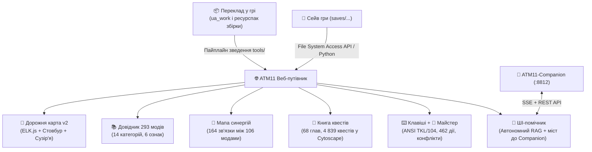

# 🌟 All the Mods 11 — Український путівник (ATM11 Guide)

[](https://minecraft.net)
[](https://www.curseforge.com/minecraft/modpacks/all-the-mods-11)
[](https://github.com/Shchensnevych/atm11_guide)
[](https://github.com/Shchensnevych/ATM11-Companion)
[](LICENSE)

> Сучасний, інтерактивний та надшвидкий веб-довідник українською мовою для модифікованої збірки **All the Mods 11** (Minecraft 26.1.2, NeoForge).

Путівник створений для того, щоб гравець не губився серед 290+ складних технічних і магічних модів, бачив цілісну картину розвитку до **ATM Star**, міг вирішити конфлікти 460+ гарячих клавіш та автоматично відстежував виконання квестів і завдань безпосередньо зі свого файлу збереження.

---

## 🗺️ Ключові можливості та розділи



### 1. 🌳 Інтерактивна дорожня карта (Roadmap v2)
- **Дерево розвитку згори вниз**: побудоване на потужному рушії верстки графу **ELK Layout** та чистій векторній SVG-графіці.
- **Головний золотий стовбур**: чітко показує магістральний шлях розвитку («Розділ 1» та «Розділ 2»), рейка етапів ліворуч дозволяє миттєво переходити між технологічними епохами.
- **Режим «За модами» (сузір'я)**: перемикання у вигляд модульних сузір'їв навколо хабів ключових модів.
- **Стани віх**: `✔` виконано (підтягується з сейву або відзначається вручну), `!` доступно (усі передумови виконано), `🔒` заблоковано.
- **Підсвічування зв'язків**: суцільні лінії передумов, пунктирні синергії та точкові альтернативи. Підтримується пошук віхи за назвою мода, мінікарта та масштабування двома пальцями / колесом.

### 2. 📚 Довідник 293 модів збірки
- **14 тематичних категорій (класів)**: Техніка, Енергія, Сховища, Логістика, Ресурси, Ферми й їжа, Магія, Спорядження, Дослідження, Боси й данжі, Декор, Зручність, Бібліотека, Оптимізація.
- **Піктограми можливостей у світі**: наочні позначки для вимірів, босів, підземель, біомів, нових руд та істот.
- **Зручні картки модів**: логотип, приналежність до категорій, зв'язок із базовими модами («доповнення до...»), стислий опис українською, лічильник предметів/блоків та піктограми контенту.
- **Швидкі фільтри**: миттєвий пошук за назвою чи описом, фільтри «лише описані», «без доповнень», «бібліотеки й оптимізація», сортування за назвою або кількістю контенту.

### 3. 📜 Книга квестів (Chapters & Quests)
- **4 839 квестів у 68 главах** повністю українською мовою.
- Візуалізація на базі графового рушія **Cytoscape.js** зі збереженням точного просторового розташування квестів із книги FTB Quests у грі.
- Кольорове кодування залежностей, форматування описів, відображення завдань, нагород та іконок предметів.
- Відображення прогресу: `✔ виконано` (зелений контур) та `⏳ у процесі` (блакитний контур).

### 4. 🌿 Гілки розвитку (Branches) та 🔗 Мапа синергій (`#/synergy`)
- **26 покрокових гілок** для глибоких модів (магія, техніка й енергія, ресурси й ферми, виміри й боси, спорядження) зі статусом виконання квестів у сейві та перевіреними джерелами `src` / `ref`.
- **Інтерактивна мапа синергій (`#/synergy`)**: 164 підтверджені міжмодові зв'язки у 12 ігрових класах — кругова діаграма «класи ↔ класи» з клікабельними дугами та 3-колонкова хаб-схема «мод у центрі» з живими SVG-лініями.
- **Глобальний пошук у шапці (`/`)**: миттєвий пошук по 6 200 записах (моди, віхи, гілки, глави, квести, предмети, клавіші).

### 5. ⌨️ Графічна мапа клавіатури й миші + 🧭 Майстер конфліктів (`#/keys`)
- **Інтерактивна клавіатура**: повна модель ANSI TKL 87 або 104 клавіші + миша (ЛКМ, ПКМ, СКМ, Button 4, Button 5).
- **Аналіз 462 дій**:
  - Розподіл за 12 категоріями та 5 контекстами (у світі, з предметом, верхи, у вікні інвентарю, F3-екран).
  - Автоматичне виявлення жорстких конфліктів (однакові клавіші в одному контексті) та потенційних зіткнень.
  - Список **важливих непризначених дій** із готовими рекомендаціями щодо вільних комбінацій (Ctrl+літера, кругове меню Keybind Bundles тощо).
- **План оптимізації та 🧭 Майстер конфліктів**: вкладка «План» із перемикачем «Як зараз / З планом» та інтерактивний «Майстер» підбору безпечних вільних сполучень (з урахуванням Balm/Kuma та клавіш компаньйона) із копіюванням готових рядків для `options.txt`.
- **Завантаження власного `options.txt`**: локальний розбір конфігурації клавіш прямо у браузері через `localStorage`.

### 6. 💾 Живий зчитувач сейвів (Progress Reader)
- Зчитування прогресу без встановлення сторонніх серверів: натисніть **«📂 Вказати теку гри»** у верхній панелі, і браузер через сучасний **File System Access API** прочитає теку інстансу `saves/<світ>/` (`level.dat`, `ftbquests`, досягнення, статистику, стиснені Gzip NBT інвентарю та вкладених сумок), автоматично оновивши стан віх на карті та квестів.

### 7. 🤖 Вбудований ШІ-помічник і локальний RAG (`#/assistant`)
- **Автономний RAG у браузері (у т. ч. онлайн на GitHub Pages)**: миттєвий гібридний пошук (BM25 + український стемер + синоніми ATM11 + триграми) і радник «Наступні кроки за сейвом» без потреби у зовнішніх API-ключах чи серверах.
- **Підключення до Companion-сервера (`:8812`)**: коли на ПК запущено [ATM11-Companion](https://github.com/Shchensnevych/ATM11-Companion), сайт автоматично підхоплює живий зв'язок через SSE — синхронізує світ, візуальні слоти інвентарю/Curios/ранців, **5-вкладкову панель «Мої сховища»** (`Усі / Предмети / Рідини / Енергія / Зони`), енергобаланс бази FE, керування кількома базами (`⭐`), живий журнал подій та Vision-аналіз скріншотів `F2`.

---

## 🚀 Як відкрити та запустити

Путівник працює локально в будь-якому сучасному браузері. Оскільки проєкт використовує ES-модулі та локальні JSON-дані, відкривати його потрібно через легкий локальний веб-сервер (пряме відкриття через `file:///` блокується політикою CORS у браузерах):

1. **Запуск у 1 клік (Windows):**
   - Запустіть файл [`start.bat`](start.bat) у корені проєкту — він підніме легкий локальний сервер і автоматично відкриє `http://localhost:8811`.
2. **Через Python:**
   ```bash
   py -I -X utf8 -m http.server 8811 --directory docs
   ```
3. **Через VS Code:**
   - Встановіть розширення **Live Server** і натисніть *Go Live* для теки `docs/`.

---

## 🛠️ Архітектура та стек технологій

- **Frontend Core**: Чистий Vanilla JavaScript (ES2022 Modules, `@ts-check`), легка реактивна DOM-бібліотека, збереження стану сторінок у `sessionStorage`.
- **Стилізація**: Чистий адаптивний CSS3 з типовою темною «ігровою» темою та світлою темою «Slate Paper» (оптимізований під смартфони, ноутбуки `1280–1536 px` і монітори 1080p / 2K / 4K; `0 !important`).
- **Графові рушії**:
  - [ELK.js](https://github.com/kieler/elkjs) — автоматична верстка дерева розвитку дорожньої карти.
  - [Cytoscape.js](https://js.cytoscape.org/) — рендеринг графа квестів.
- **Пайплайн збору та валідації даних (`tools/`)**:
  - `tools/extract_mods.py`: вилучення метаданих 293 модів, описів і 184 логотипів із jar-файлів.
  - `tools/extract_quests.py` + `tools/extract_game_names.py`: парсинг 68 глав і 4 839 квестів FTB Quests українською зі знімками назв, властивостей стосів, рідин і зачарувань прямо з гри.
  - `tools/extract_icons.py`: генерація **4 295 PNG-іконок** предметів, квестів та ізометричних 3D-блоків із jar-файлів.
  - `tools/extract_recipes.py` + `tools/extract_kubejs.py` + `tools/build_recipes_db.py`: «сито» активних рецептів і тегів KubeJS у пісочниці Node та збірка SQLite-графа рецептів для компаньйона.
  - `tools/extract_keys.py` + `tools/build_keys.py`: аналіз 462 дій та правил зіткнень.
  - `tools/build_data.py` + `tools/audit_fidelity.py`: зведення, перевірка 6 248 машинних посилань `ref` та контроль цілісності (`--check`).

---

## 📁 Структура репозиторію

```text
atm11_guide/
├── docs/                   # Веб-додаток путівника
│   ├── index.html          # Головна точка входу
│   ├── css/                # Модульні таблиці стилів
│   ├── js/                 # Модульний JavaScript (core, components, views, graph)
│   ├── data/               # Зведені JSON-дані (mods, roadmap, quests, keys, classes)
│   ├── img/                # Логотипи модів, іконки предметів (600+ шт.), favicon
│   └── vendor/             # Графові бібліотеки (elk.bundled.js, cytoscape.min.js)
├── content/                # Описи, категорії, синергії та правила дорожньої карти
│   ├── classes.json        # 14 класів модів і кольорова палітра
│   ├── roadmap.json        # Віхи дерева розвитку, стовбур, вимоги done_by
│   ├── keys.json           # 179 правил категорій, контекстів і порад для клавіш
│   └── mods/               # Ручні описи, поради й нюанси українською
├── tools/                  # Python CLI утиліти для екстракції та зведення даних
├── start.bat               # Меню швидкого локального запуску та оновлення даних
├── DOCUMENTATION.md        # Детальний посібник користувача
├── CHANGELOG.md            # Історія змін та реалізованих функцій
└── README.md               # Цей документ
```

---

## 🗺️ Дорожня карта та плани розвитку

- [x] Інтерактивне дерево розвитку (Roadmap v2) на рушії ELK.js
- [x] Автоматичний імпорт прогресу та завдань безпосередньо зі збереження гри (`saves/`)
- [x] Інтерактивна мапа 462 гарячих клавіш з автоматичним виявленням конфліктів
- [x] Опис усіх 293 модів збірки (класи, можливості, синергії)
- [x] Автономний ШІ-помічник поруч із грою та міст до десктопного оверлею `ATM11-Companion`
- [x] Квести: іконки предметів на схемі, режим читання списком, огляди 68 глав
- [x] «Сито» достовірності: усі 293 моди, 164 синергії, 64 віхи, 26 гілок і 68 оглядів глав мають перевірені машинні джерела `ref` із файлів збірки (`tools/audit_fidelity.py` → Виправити: 0)
- [x] Публікація веб-путівника на GitHub Pages (`https://shchensnevych.github.io/atm11_guide/`)
- [ ] Дописи до «німих» квестів решти технічних глав (Oritech, Bounty Board тощо)

---

## 🌐 Українська екосистема All the Mods 11

Для максимального комфорту під час гри путівник розроблено в синергії з іншими проєктами екосистеми:

| Проєкт | Опис | Посилання |
| :--- | :--- | :--- |
| **🌐 atm11_guide** | Цей інтерактивний веб-путівник (дорожня карта v2, довідник 293 модів, квести, клавіші) | [GitHub](https://github.com/Shchensnevych/atm11_guide) |
| **🤖 ATM11-Companion** | Плаваючий ігровий HUD-оверлей (`Alt+Q`), міст :8812, чат-команди KubeJS, Vision AI по `F2` | [GitHub](https://github.com/Shchensnevych/ATM11-Companion) |

---

## 🔒 Безпека

Правила для всіх змін (ключі, локальний міст компаньйона, HTML, ШІ, KubeJS) і чекліст перед комітом — у [`.agent/workflows/security.md`](.agent/workflows/security.md).

## 📜 Ліцензія та подяка

- Проєкт створено в рамках української локалізації та підтримки спільноти гравців **All the Mods 11**.
- Вихідний код розповсюджується під ліцензією [MIT](LICENSE).
- Метадані модів, текстури та логотипи належать команді **All the Mods** та відповідним авторам модифікацій.
